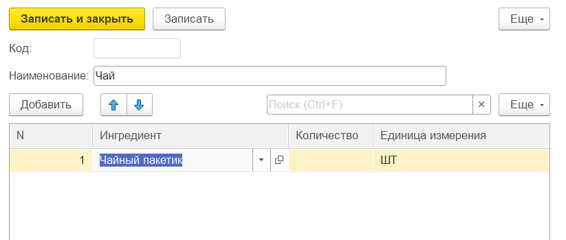
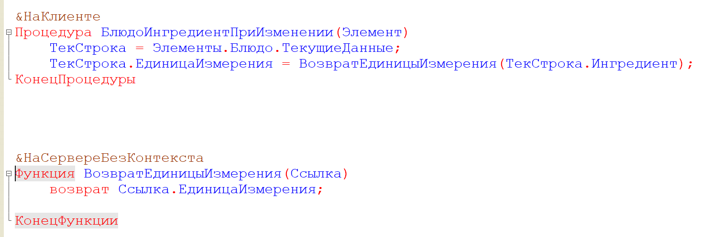
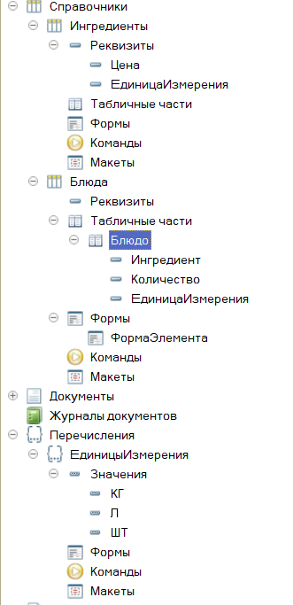
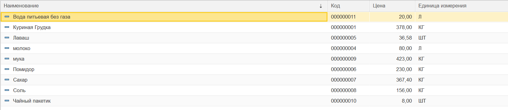

# 🍳 Автоподстановка единиц измерения в рецептах

## Что делает

Когда в табличной части «Состав блюда» выбираешь ингредиент, система сама подставляет его единицу измерения (кг, л, шт). Не нужно выбирать вручную — данные берутся напрямую из карточки продукта.

## Как реализовано

### Клиент-серверное взаимодействие

Обработчик события `ПриИзменении` находится на клиенте (&НаКлиенте). Для получения данных используется функция с директивой &НаСервереБезКонтекста.

> **Зачем это нужно:** Нам требуется только один реквизит из справочника. Обычный серверный вызов передал бы на сервер весь объект формы, создав лишний трафик. Директива БезКонтекста выполняет изолированный запрос к базе данных и возвращает только результат. Это базовая оптимизация для форм с большими таблицами.

### Работа со ссылками

На сервер передается не строка с названием, а типизированная ссылка `СправочникСсылка.Ингредиенты`. Платформа использует её для мгновенного индексированного поиска, что исключает ошибки даже при совпадающих наименованиях.

### Обновление без перерисовки

Изменение поля происходит через `Элементы.Блюдо.ТекущиеДанные`. Мы работаем напрямую со строкой таблицы в памяти клиента. Форма не перезагружается полностью, интерфейс остается отзывчивым.

### Целостность данных

Единица измерения хранится исключительно в справочнике «Ингредиенты». В табличной части блюда она подтягивается по ссылке. При изменении данных в справочнике все новые рецепты автоматически получают актуальную информацию.

## Итог

Пользователь не тратит время на ручной ввод, ошибки исключены, а код работает оптимально без лишней нагрузки на платформу.